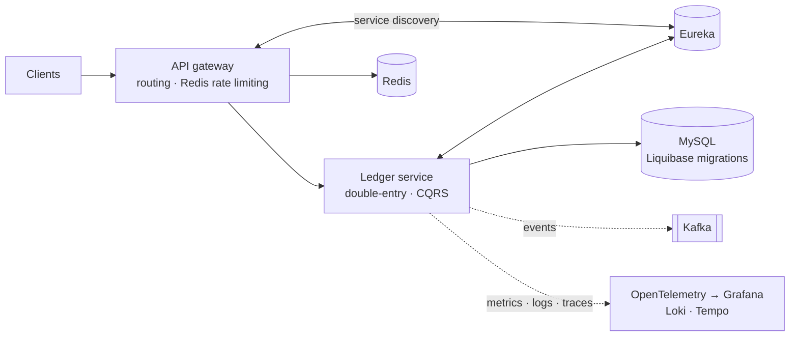

# Ledgerline

A core banking system built as Spring Boot microservices. It follows clean architecture and models a
double-entry ledger as its accounting core.


[](https://github.com/naksh1414/ledgerline/actions/workflows/ci.yml)

## Status

Under active development.

| Module                | State       | Purpose                                     |
|-----------------------|-------------|---------------------------------------------|
| `cbs-discovery-server`| Done        | Eureka service registry                     |
| `cbs-api-gateway`     | Done        | Single entry point, routing, rate limiting  |
| `cbs-core`            | Done        | Shared error handling, audit, observability |
| `cbs-ledger-service`  | In progress | Double-entry bookkeeping                    |

`cbs-testing` and `cbs-coverage` hold shared test helpers and aggregated coverage.

## Stack

Java 25, Spring Boot 4, Spring Cloud, MySQL, Kafka, Redis, Eureka, Liquibase, Docker, and
Grafana/Loki/Tempo for metrics, logs and traces.

Quality tooling: JUnit, Mockito, ArchUnit, PMD, Pitest (mutation testing), JaCoCo.

## Architecture



Every service is split into three layers. ArchUnit tests fail the build when a layer reaches
somewhere it should not.

| Layer            | Contains                                       | May depend on          |
|------------------|------------------------------------------------|------------------------|
| `domain`         | Entities, commands, queries, business rules    | nothing                |
| `infrastructure` | Persistence, messaging, external calls         | `domain`               |
| `application`    | Controllers, Spring config, web classes        | `domain`, `infrastructure` |

Domain entities are plain Java. They are never annotated with `@Entity`; JPA models live in
`infrastructure`.

## Features

- CQRS-style commands and queries
- Automatic API audit logging through Spring AOP
- Uniform error responses using Spring `ProblemDetail`
- Redis rate limiting at the gateway
- OpenAPI/Swagger docs
- Liquibase database migrations
- Observability with Grafana, Loki and Tempo

Error response shape:

```json
{
    "type": "https://docs.oracle.com/en/java/javase/25/docs/api/java.base/java/lang/RuntimeException.html",
    "title": "Requested Ledger Not Found",
    "status": 404,
    "detail": "Ledger with the requested id not found",
    "instance": "/ledger/protected/v1/ledgers/33bff7c7-77ee-4c51-9ee0-c870b437f82e",
    "category": "Resource Not Found",
    "timestamp": "2025-04-22T18:45:43.927431130Z"
}
```

## Run it locally

Requires Java 25, Maven, Docker and Docker Compose.

```bash
git clone https://github.com/naksh1414/ledgerline.git
cd ledgerline

# create your local environment file and fill in the credentials
cp .env.example .env

# build and push images to the local Docker daemon (Jib)
mvn clean install

export EUREKA_USERNAME=admin
export EUREKA_PASSWORD=admin

# infrastructure and backbone services
docker compose up -d
```

Then start the ledger service from your IDE or with Maven.

| What          | URL                                    |
|---------------|----------------------------------------|
| API gateway   | http://localhost:8080                  |
| Swagger UI    | http://localhost:8080/swagger-ui.html  |
| Eureka        | http://localhost:8080/eureka/web (`admin` / `admin`) |
| Grafana       | http://localhost:3000/dashboards       |

Import the prebuilt dashboards from `Docker/grafana/` into Grafana.

## Tests

```bash
mvn test
```

Runs unit tests (including the `Money` value object) and the ArchUnit rules on every push via
GitHub Actions.

See [Testing.md](Testing.md) for testing conventions.

## Contributing

Fork, branch, open a pull request. See [CONTRIBUTING.md](CONTRIBUTING.md).

## License

MIT. See [LICENSE](LICENSE).

## Contact

Nakshatra Manglik, [nakshatramanglik14@gmail.com](mailto:nakshatramanglik14@gmail.com)
